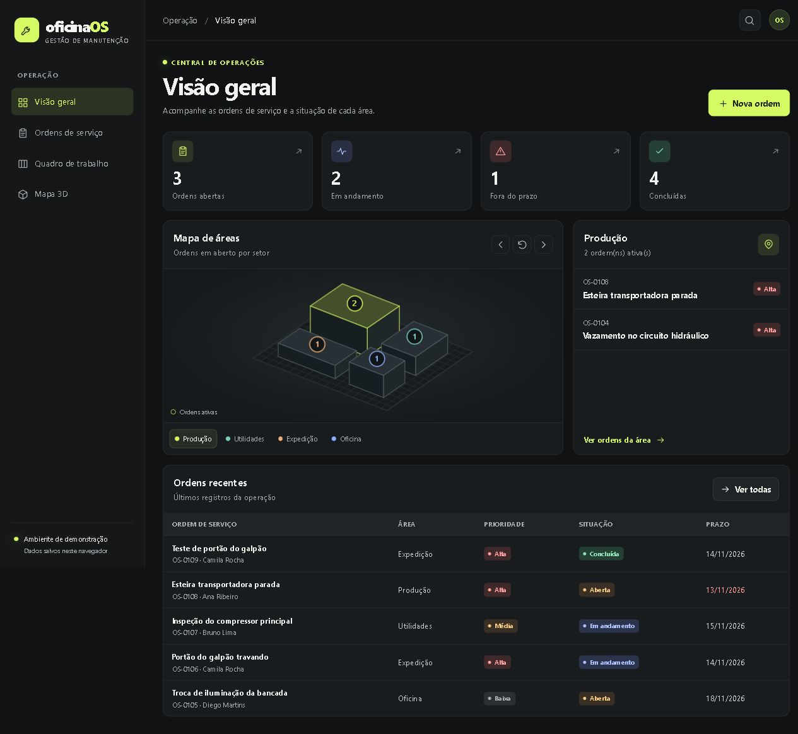

# Oficina OS

Painel de ordens de serviço para equipes de manutenção. O tema escuro destaca prioridades, prazos e a distribuição dos chamados por área.



- **Visão geral** com indicadores de ordens abertas, em andamento, atrasadas e concluídas.
- **Ordens de serviço** com busca, filtros, responsáveis, histórico e exportação CSV dos resultados.
- **Quadro de trabalho** com cartões agrupados por situação.
- **Mapa 3D** com uma maquete isométrica em Canvas. Use as setas para girar e selecione uma área para consultar seus chamados ativos.

## Executar

Com Node.js instalado, abra a pasta do projeto e execute:

```sh
npm run dev
```

Abra [http://127.0.0.1:8094](http://127.0.0.1:8094). No Windows, se necessário, use `node server.js` diretamente.

## Fluxo de demonstração

1. Abra uma ordem para registrar o problema, a prioridade e o prazo.
2. Atribua o trabalho a um responsável e altere a situação para **Em andamento**.
3. Ao concluir, descreva o serviço realizado. A ordem guarda a alteração no histórico e os indicadores são atualizados.

O projeto vem com ordens fictícias e salva as alterações no navegador. Cada navegador mantém sua própria cópia. Uma implantação compartilhada entre equipes precisaria de um banco central e autenticação.

## Estrutura

| Arquivo | Responsabilidade |
| --- | --- |
| `index.html` e `styles.css` | Estrutura e aparência responsiva |
| `src/app.js` | Navegação, telas, formulários e interações |
| `src/store.js` | Dados fictícios, regras das ordens e persistência |
| `src/map.js` | Projeção 3D, rotação e seleção de setores |
| `src/icons.js` | Ícones da interface |
| `server.js` | Servidor local para desenvolvimento |
